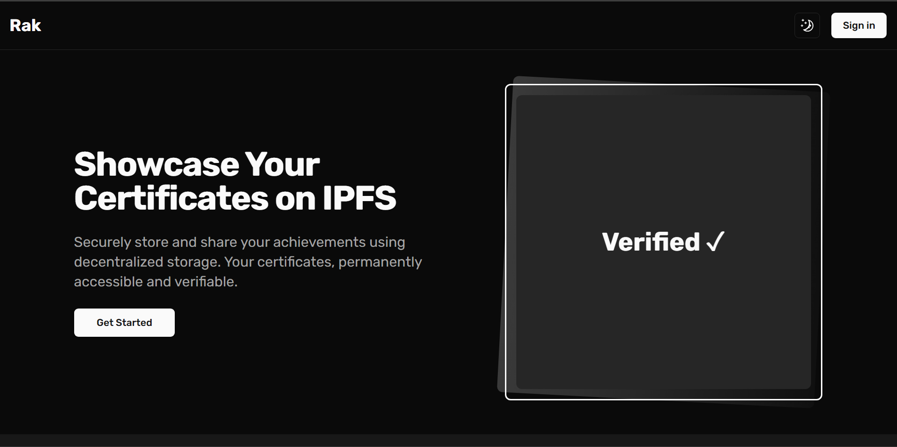

# Rak - Decentralized Certificate Verification Platform

<div align="center">
  
  <p><em>Secure your achievements on the decentralized web</em></p>
</div>

---

> 🚀 **Rak is open source and actively maintained!** We welcome contributions, feature requests, and feedback. [Join us on GitHub](https://github.com/PriyanshuPz/rak) to help shape the future of decentralized credential verification.

---

## Introduction

**Rak** is a modern platform that leverages the **InterPlanetary File System (IPFS)** to provide secure, permanent, and tamper-proof storage for your certificates and achievements. In an era where digital credentials are increasingly important, Rak ensures your accomplishments are **verifiable**, **resilient**, and **accessible forever**.

Unlike traditional certificate storage solutions that rely on centralized servers, Rak stores your certificates on a distributed network — making them resistant to censorship, server failures, and data loss. Each certificate receives a unique **Content Identifier (CID)** that serves as cryptographic proof of the document's authenticity.

## Table of Contents

* [Features](#features)
* [Tech Stack](#tech-stack)
* [Getting Started](#getting-started)

  * [Prerequisites](#prerequisites)
  * [Installation](#installation)
* [Usage](#usage)
* [Architecture](#architecture)
* [Contributing](#contributing)
* [License](#license)

## Features

* 🔗 **Decentralized Storage**: Certificates are stored on IPFS to ensure permanent accessibility
* ✅ **Easy Verification**: Share a simple link to verify credentials without needing an account
* 💡 **User-Friendly Interface**: Responsive, modern design that works seamlessly across devices
* 🌓 **Dark/Light Mode**: Toggle between visual themes for accessibility and comfort
* 🔐 **Secure Authentication**: Sign in via Google or GitHub using NextAuth
* 🛡️ **Privacy Controls**: Control who can view and access your certificates

## Tech Stack

* **Frontend**: Next.js, React, Tailwind CSS, Shadcn UI
* **Backend**: Next.js API Routes
* **Authentication**: NextAuth.js
* **Database**: Prisma + MongoDB
* **Storage**: IPFS via Filebase
* **Deployment**: Vercel

## Getting Started

### Prerequisites

* [Node.js](https://nodejs.org/) (v18+)
* [Bun](https://bun.sh/) (recommended) or npm/yarn
* [MongoDB](https://mongodb.com/) (local or cloud)

### Installation

```bash
git clone https://github.com/PriyanshuPz/rak.git
cd rak
bun install # or npm install
```

Create a `.env` file with the following:

```env
DATABASE_URL="mongodb://localhost:27017/rak"

AUTH_GOOGLE_SECRET="google-secret-key"
AUTH_GOOGLE_ID="google-id"

AUTH_GITHUB_SECRET="github-secret-key"
AUTH_GITHUB_ID="github-id"

AUTH_URL="http://localhost:3000/api/auth"
AUTH_SECRET="secret-key"

NEXT_PUBLIC_URL="http://localhost:3000"
NEXT_PUBLIC_IPFS_KEY="ipfs-key"

NEXT_PUBLIC_FLAGSMITH_ENV="flagsmith-environment-id"
```

Generate the Prisma client:

```bash
bunx prisma generate
```

Start the development server:

```bash
bun dev # or npm run dev
```

Visit: [http://localhost:3000](http://localhost:3000)

## Usage

1. **Log in** using GitHub or Google
2. **Upload certificates** to IPFS via Rak
3. **Share or verify** certificates using unique, public CIDs

## Architecture

* **App Router** (Next.js 13+) with Server & Client Components
* **NextAuth.js** for OAuth2-based secure login
* **Filebase** integration for IPFS uploads
* **MongoDB** for metadata storage and user profiles

## Contributing

Rak is open source and **actively maintained**. Contributions, bug reports, and feature requests are not just welcome — they’re encouraged!

### How to Contribute:

1. **Fork** this repo
2. Create your feature branch: `git checkout -b feature/awesome-feature`
3. Commit your changes: `git commit -m 'Add awesome feature'`
4. Push to your branch: `git push origin feature/awesome-feature`
5. Open a **Pull Request**

🛠️ We track active work and roadmap in [GitHub Issues](https://github.com/PriyanshuPz/rak/issues). Feel free to suggest features or report bugs there.

Read our [Contributing Guidelines](CONTRIBUTING.md) for more.

## License

This project is licensed under the [MIT License](LICENSE).

---

<div align="center">
  <strong>Built with ❤️ for the decentralized web — and open to all contributors!</strong>
</div>
